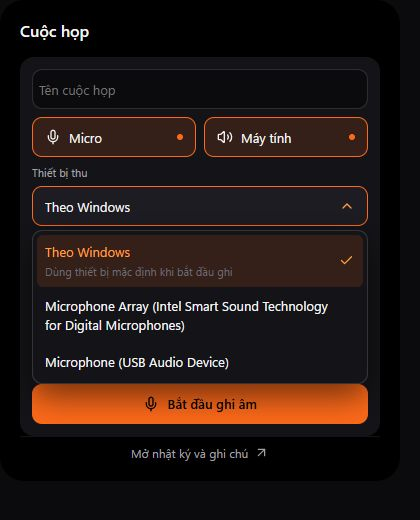

# Báo cáo triển khai file / note desktop / meeting

Ngày 2026-11-01. Nền checkout `f4d320a`, không commit/push hoặc thay release đã phát hành.

**Cập nhật sau yêu cầu phát hành:** source phiên này được đưa vào [v0.1.2](../releases/v0.1.2.md), đã build exe/NSIS/portable và chạy lại 238 Rust + 81 frontend, fmt/clippy/check sạch. Sửa command mở note desktop thành async trước đóng gói. Các mô tả “chưa release” bên dưới là trạng thái lúc kết thúc QA ban đầu; giới hạn nghiệm thu vẫn giữ nguyên.

## Kết quả

- Kệ file bỏ trần 3, chọn nhiều/tất cả, drag/copy file thực, ZIP có tiến trình/hủy, đổi một ảnh và phân trang.
- Note desktop có topmost, cỡ chữ 12–40, sửa/xóa/đóng, countdown và scheduler chung; CAS/draft chống mất sửa đổi.
- Meeting có capture mic/system, Opus liên tục, hotkey đánh dấu lùi 15 giây, xuất clip nền, lịch sử/timeline/notes, Groq tùy chọn và ZIP.
- Dropdown meeting thay riêng, cuộn/keyboard/tên dài. Fixture UI rộng 400 px có scrollWidth đúng 400 px; ảnh dưới là dữ liệu UI giả, không phải cuộc họp thật.

## Kiểm tra

| Kiểm tra | Kết quả |
|---|---|
| `pnpm check` | Đạt, 0 warnings, 497 khóa i18n |
| `pnpm test` | 81 đạt / 27 file |
| `pnpm build` | Đạt, gồm entry note-desktop và video |
| `cargo test --quiet` | 238 đạt, 4 ignored |
| fmt / clippy all-targets `-D warnings` | Đạt |
| Codec Opus/preroll | Decode được và granule clip đúng thời lượng |
| Native capture system + enumerate device | Đạt, 2 thiết bị active |
| Native mic | Windows Access denied `0x80070005`; không đổi privacy settings |
| Groq live bằng mẫu công khai | WAV và Ogg Opus đạt; không gửi audio cá nhân |

## Giới hạn

Đây là bản source/debug thử nghiệm. Không có installer/release mới; không kết luận hoàn tất nghiệm thu từ test logic. Chưa test cuộc họp 60 phút, mic+loopback thực, echo/độ lệch nguồn, native play/seek, tất cả crash/recovery, quota/retry thật, RAM/CPU/dung lượng exe. Chưa kiểm tra drag nhóm vào chat tạo attachment thật hoặc note desktop nhiều DPI/bộ gõ/báo chuông khi đóng view.

Khác kế hoạch ban đầu đã ghi rõ trong module docs: output shelf do người dùng chọn nơi lưu; chuyển ảnh một mục, đầu vào PNG/JPEG tĩnh; batch thêm file lớn chưa có progress/cancel/báo cáo từng lỗi; note mở theo yêu cầu, chưa tự restore khi restart/clamp đủ DPI. Key Groq nhúng native theo yêu cầu chủ dự án, không có backend.

## Kết thúc QA

Chủ dự án chọn đóng QA và dọn cache. Đã dừng app QA và Vite, đóng tab preview; xóa hai fixture preview và thư mục bindings sinh nhầm. Script `clean-build.ps1` đã dọn 9,050 GiB theo tổng kích thước file; dung lượng trống ổ đĩa tăng thực tế **7,670 GiB**. Chênh lệch có thể do hardlink/cấp phát và hoạt động khác trên ổ. Giữ SQLite/settings/audio/note, dependencies, dist, installer và release cũ; script xác minh hash release không đổi. Lần Rust build tiếp theo sẽ phải biên dịch lại cache.
