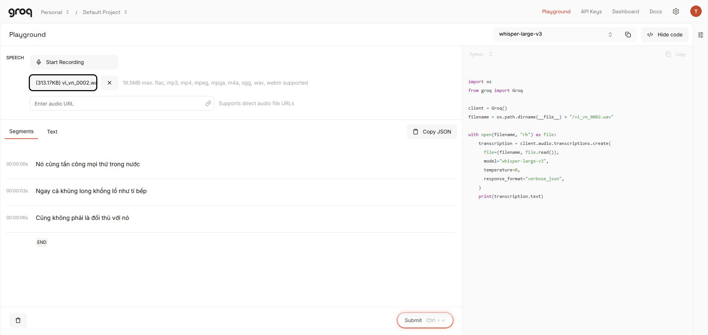

# Kiểm thử tiếng Việt trên Groq

Ngày kiểm tra: 2026-11-01. Kết luận: **dùng được làm transcript nháp cho bản thử nghiệm meeting**, chưa đạt điều kiện coi transcript là biên bản chính xác hoặc phát hành rộng. Tên riêng và thuật ngữ vẫn sai; giao diện phải cho nghe lại và sửa.

## Phương pháp

- Groq Playground, tài khoản đã được chủ dự án đăng nhập; chọn `whisper-large-v3`, `temperature=0`, `response_format=verbose_json`.
- Upload trực tiếp ba WAV công khai, 16 kHz mono, từ bản đóng gói [Google FLEURS của FluidInference](https://huggingface.co/datasets/FluidInference/fleurs-full/tree/main/vi_vn), giấy phép CC BY 4.0. Ghi công Google FLEURS / Conneau và cộng sự (2022), FluidInference đóng gói lại.
- Ba lượt đầu để tự nhận diện ngôn ngữ. Thử lại mẫu 0002 với `language=vi` để kiểm tra lỗi thuật ngữ; kết quả không đổi.
- Không gửi ghi âm cá nhân, không tạo/lấy API key và không thay đổi gói dịch vụ. Đây là phép thử qua Playground, chưa phải kiểm thử client Rust hay backend trung gian của PCisland.
- Thời gian đo bằng đồng hồ phía điều khiển UI từ trước click Submit đến khi nút Submit xuất hiện lại và DOM chứa kết quả mới. Bao gồm upload, mạng, xử lý và giao diện; không phải thời gian suy luận riêng của Groq.

## Kết quả

| Mẫu | Audio | Thời gian UI | Nhận xét |
|---|---:|---:|---|
| `vi_vn_0000.wav` | 11,34 giây | Không có phép đo tin cậy | Khớp bản chuẩn sau bỏ dấu câu và viết hoa |
| `vi_vn_0001.wav` | 7,26 giây | 1,921 giây | Springboks thành Spring Book; chuỗi thành chui |
| `vi_vn_0002.wav` | 10,02 giây | 2,085 giây | T. rex thành tí bếp; phần còn lại khớp |
| 0002 thử lại với `language=vi` | 10,02 giây | 1,539 giây | Lỗi tí bếp vẫn còn |

### Mẫu 0000

Bản chuẩn:

> văn hóa và bộ lạc cổ xưa đã bắt đầu giữ những con vật này để dễ lấy sữa tóc thịt và da

Groq:

> Văn hóa và bộ lạc cổ xưa đã bắt đầu giữ những con vật này để dễ lấy sữa, tóc, thịt và da

### Mẫu 0001

Bản chuẩn:

> đối với springboks trận này đã giúp đội tuyển kết thúc chuỗi thua 5 trận liền

Groq:

> Đối với Spring Book, trận này đã giúp đội tuyển kết thúc chui thua 5 trận liền.

### Mẫu 0002

Bản chuẩn:

> nó cũng tấn công mọi thứ trong nước ngay cả khủng long khổng lồ như t rex cũng không phải là đối thủ với nó

Groq trả ba segment, bắt đầu tại 0, 3 và 6 giây:

> Nó cũng tấn công mọi thứ trong nước
>
> Ngay cả khủng long khổng lồ như tí bếp
>
> Cũng không phải là đối thủ với nó

## Diễn giải và quyết định

Ba mẫu tổng cộng 28,62 giây chỉ chứng minh API đang hoạt động và có thể tạo bản chép tiếng Việt hữu ích. Không suy ra tỷ lệ chính xác chung, khả năng phân biệt người nói hoặc chất lượng họp 60 phút. Chưa kiểm tra giọng vùng miền, tiếng ồn, người nói chồng nhau, mic xa, tiếng Anh xen kẽ, số tiền và ngày giờ.

Trong phép thử trước trên cùng ba mẫu, Qwen3 của NoteTakers giữ đúng tên Springboks và từ chuỗi, nhưng đổi T. rex thành Tyrannosaurus; mất khoảng 27–34 giây/lượt. Đây không phải benchmark đồng thời hoặc phép đo hiệu năng tương đương. NoteTakers không được chọn làm nguồn mặc định do hạn mức 10 lượt/ngày/IP.

Chọn Groq Large V3 làm **ứng viên triển khai thử nghiệm**, cấu hình dự kiến `language=vi`; từ gợi ý chỉ là tính năng cần đánh giá, chưa có bằng chứng nó khắc phục các lỗi trên. Giữ audio gốc của clip, transcript máy và bản sửa của người dùng riêng biệt. Không tự suy diễn người nói, kết luận cuộc họp hoặc quyết định từ transcript.

Trước phát hành: chạy thêm tối thiểu 20 clip họp có quyền sử dụng, phủ các tình huống nêu trên; kiểm tra thông tin quan trọng và số liệu thủ công, đánh giá thêm clip im lặng. Không gắn nhãn “chính xác 95%” từ phép thử nhỏ này.

## Điều kiện tích hợp

- [Groq STT](https://console.groq.com/docs/speech-to-text): hỗ trợ timestamp, tham số ngôn ngữ và prompt; upload tối đa 25 MB trên free tier. Dùng endpoint transcriptions để giữ tiếng Việt.
- [Hạn mức](https://console.groq.com/docs/rate-limits): mức miễn phí công bố cho Large V3 là 20 request/phút, 2.000/ngày, 7.200 giây audio/giờ và 28.800 giây/ngày. Áp dụng theo tổ chức, có thể có ngoại lệ; không phải 8 giờ cho mỗi người dùng PCisland. Chưa xác minh hạn mức riêng của tài khoản này.
- [Bảo vệ key](https://console.groq.com/docs/production-readiness/security-onboarding): dùng key nhà phát triển ở backend trung gian để người dùng không nhập key. Backend, key, quyền triển khai và chi phí vận hành chưa được thiết lập trong phép thử này.
- URL mẫu Hugging Face trả redirect 302 bị Playground từ chối; upload file trực tiếp thành công. Client sản phẩm nên gửi multipart bytes từ file đã hoàn tất.

Kế hoạch triển khai: [Kệ file, note desktop và meeting](../plans/file-note-meeting.md).
